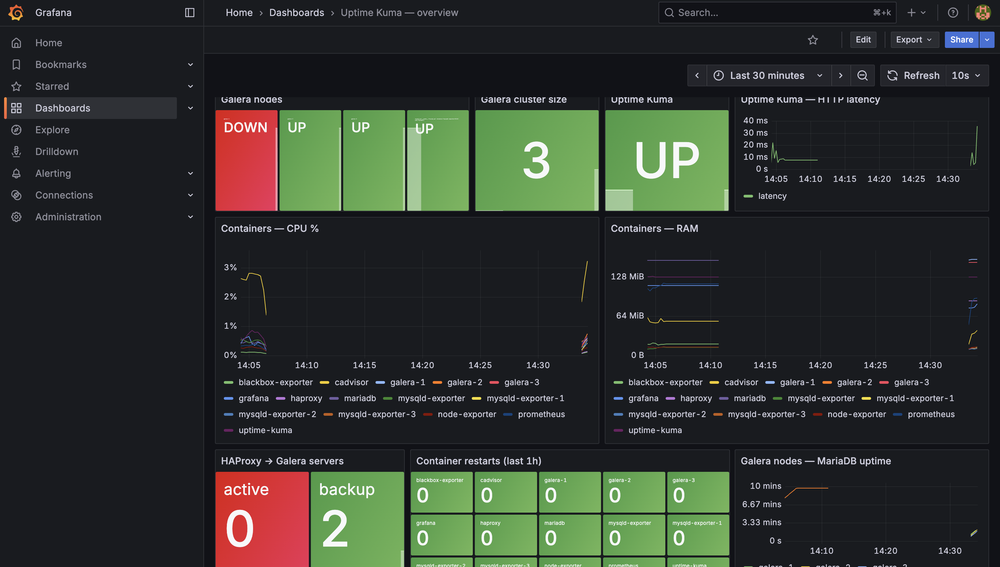
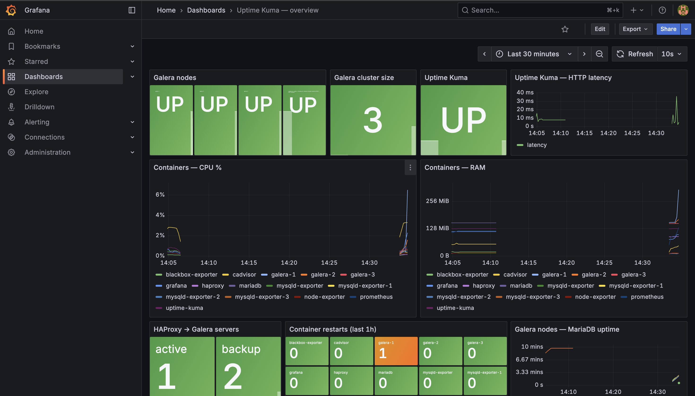

# Uptime Kuma: локальный отказоустойчивый контур мониторинга

Uptime Kuma с кластером MariaDB Galera за HAProxy и мониторингом на Prometheus и Grafana. Всё разворачивается и проверяется функциями модуля **Dagger (Go SDK)**, который управляет Docker хоста через проброшенный `docker.sock`.

## Содержание

- [Архитектура](#архитектура)
- [Структура репозитория](#структура-репозитория)
- [Требования](#требования)
- [Быстрый старт](#быстрый-старт)
- [Команды Dagger](#команды-dagger)
- [Адреса сервисов](#адреса-сервисов)
- [Проверка работоспособности](#проверка-работоспособности)
- [Chaos-тест](#chaos-тест)
- [Galera: как устроен кластер](#galera-как-устроен-кластер)
- [Дашборд Grafana](#дашборд-grafana)
- [Безопасность](#безопасность)
- [Известные особенности и ограничения](#известные-особенности-и-ограничения)
- [Остановка и очистка](#остановка-и-очистка)

## Архитектура

```
                         dagger call ...  ──(docker.sock)──►  Docker хоста
┌──────────────── слой 1: app/compose.yml ─────────────────┐
│                                                          │
│  Uptime Kuma ──► HAProxy ──► galera-1  (активная нода)   │
│    :3001          :8404 ┌──► galera-2  (резерв)          │
│                         └──► galera-3  (резерв)          │
│              синхронная репликация Galera между нодами   │
└──────────────────────────────────────────────────────────┘
               общая внешняя docker-сеть kuma-net
┌──────────────── слой 2: monitoring/compose.yml ──────────┐
│  Prometheus :9090 ◄─ cAdvisor          (CPU/RAM контейнеров)
│                   ◄─ node_exporter     (хост)            │
│                   ◄─ mysqld_exporter ×3 (каждая нода Galera)
│                   ◄─ HAProxy           (встроенный экспортер)
│                   ◄─ blackbox_exporter (доступность и latency Kuma)
│  Grafana :3000    ◄─ Prometheus (настраивается через HTTP API)
└──────────────────────────────────────────────────────────┘
```

Два слоя — это два независимых compose-проекта (`kuma-app` и `kuma-monitoring`). Их связывает внешняя сеть `kuma-net`, поэтому Prometheus обращается к сервисам приложения по именам контейнеров.

| Компонент | Зачем |
|---|---|
| Uptime Kuma 2 | приложение. MariaDB как внешнюю БД поддерживает только версия 2.x |
| MariaDB Galera ×3 | синхронная multi-master репликация, кластер переживает падение любой ноды |
| HAProxy | единая точка входа для Kuma: один писатель (galera-1), две ноды в резерве, автоматическое переключение |
| cAdvisor | CPU и RAM каждого контейнера |
| node_exporter | состояние хоста |
| mysqld_exporter ×3 | `mysql_up`, размер кластера и состояние каждой ноды Galera |
| blackbox_exporter | HTTP-проверка Kuma снаружи: `probe_success` и `probe_duration_seconds` |

## Структура репозитория

```
.
├── dagger.json                 # модуль Dagger (Go SDK)
├── .dagger/main.go             # функции: deploy-app, deploy-monitoring, configure-grafana, validate, deploy-all, chaos
├── app/                        # слой 1
│   ├── compose.yml
│   ├── .env.example
│   ├── galera/                 # образ ноды Galera: конфиг, bootstrap-обёртка, init-скрипт пользователей
│   └── haproxy/                # образ HAProxy с конфигом
├── monitoring/                 # слой 2
│   ├── compose.yml
│   ├── .env.example
│   ├── prometheus/             # образ Prometheus с конфигом
│   ├── blackbox/               # образ blackbox_exporter с конфигом
│   └── grafana/dashboards/     # дашборд, загружается через API
├── scripts/
│   ├── dagger-call.sh          # обёртка: загружает .env и вызывает dagger call с нужными аргументами
│   ├── create-exporter-user.sh # идемпотентное создание пользователя БД для экспортеров
│   ├── configure-grafana.sh    # datasource + дашборды через Grafana HTTP API
│   ├── validate.sh             # проверка всего контура
│   └── chaos.sh                # chaos-тест
└── docs/screenshots/           # скриншоты дашборда
```

Конфиги Prometheus, blackbox, Galera и HAProxy **запекаются в образы** (`COPY` в Dockerfile), а не монтируются bind-маунтом. Причина в том, что `docker compose` выполняется внутри контейнера Dagger, а bind-маунт ищет путь на хосте Docker, где этих файлов нет. Контекст сборки образа передаётся демону вместе с файлами, поэтому такой способ работает и из Dagger, и вручную.

## Требования

- Linux, macOS или Windows через WSL2
- Docker Engine или Docker Desktop с Compose v2 (проверено на Docker 29.2, Compose 5.1, macOS arm64)
- [Dagger CLI](https://docs.dagger.io/install) v0.21 (`brew install dagger/tap/dagger`)
- Go отдельно ставить **не нужно**, модуль собирает Dagger
- свободные порты 3000, 3001, 8404, 9090
- около 5 ГБ свободного места на диске под образы и кеш Dagger

## Быстрый старт

```bash
git clone <repo> kuma-monitoring && cd kuma-monitoring

# 1. пароли: скопировать шаблоны и задать свои значения
cp app/.env.example app/.env
cp monitoring/.env.example monitoring/.env

# 2. развернуть и проверить всё одной командой
./scripts/dagger-call.sh deploy-all
```

Первый запуск занимает 3–5 минут: Dagger скачивает engine и собирает модуль, ноды Galera поднимаются по очереди и получают данные через SST. В конце вывода должно быть `ALL CHECKS PASSED`.

После этого откройте http://localhost:3001 и создайте администратора Uptime Kuma.

## Команды Dagger

`scripts/dagger-call.sh` берёт пароли из `.env` и передаёт их в Dagger как **секреты** (`env://...`). Их можно вызывать и напрямую, без обёртки:

```bash
set -a; source app/.env; source monitoring/.env; set +a

# слой 1: Galera ×3 + HAProxy + Uptime Kuma, пользователь для экспортеров
dagger call deploy-app --sock=/var/run/docker.sock \
  --db-root-password=env://DB_ROOT_PASSWORD --db-password=env://DB_PASSWORD \
  --sst-password=env://SST_PASSWORD --exporter-password=env://EXPORTER_DB_PASSWORD

# слой 2: Prometheus, Grafana, экспортеры
dagger call deploy-monitoring --sock=/var/run/docker.sock \
  --grafana-password=env://GRAFANA_ADMIN_PASSWORD --exporter-password=env://EXPORTER_DB_PASSWORD

# datasource и дашборд через HTTP API Grafana
dagger call configure-grafana --grafana=tcp://localhost:3000 \
  --grafana-password=env://GRAFANA_ADMIN_PASSWORD

# проверка всего контура
dagger call validate --prometheus=tcp://localhost:9090 --grafana=tcp://localhost:3000 \
  --grafana-password=env://GRAFANA_ADMIN_PASSWORD

# всё вместе: deploy-app → deploy-monitoring → configure-grafana → validate
dagger call deploy-all --sock=/var/run/docker.sock \
  --prometheus=tcp://localhost:9090 --grafana=tcp://localhost:3000 \
  --db-root-password=env://DB_ROOT_PASSWORD --db-password=env://DB_PASSWORD \
  --sst-password=env://SST_PASSWORD --exporter-password=env://EXPORTER_DB_PASSWORD \
  --grafana-password=env://GRAFANA_ADMIN_PASSWORD

# chaos-тест (цели: galera-1, galera-2, galera-3, uptime-kuma)
dagger call chaos --sock=/var/run/docker.sock --prometheus=tcp://localhost:9090 --target=galera-1
```

Как это устроено:

- **`--sock`** пробрасывает сокет Docker хоста в контейнер с `docker` CLI. Команды `docker compose` выполняются внутри Dagger, а контейнеры создаются на хосте.
- **`--grafana` и `--prometheus`** типа `Service` работают через host service Dagger: `tcp://localhost:PORT` прокладывает туннель от контейнера функции к порту на хосте.
- **Исходники** передаются аргументом `src` с `+defaultPath="/"`, а `.env` и `.git` исключены через `+ignore`. Пароли попадают в контейнер только как секреты.
- **Все функции идемпотентны.** Compose приводит контейнеры к нужному состоянию, пользователь экспортера создаётся через `CREATE USER IF NOT EXISTS` + `ALTER USER`, datasource обновляется через PUT, а дашборд загружается с `overwrite: true`.
- **Fail fast.** Если какой-то секрет пустой, функция падает **до** `compose up`. Иначе compose пересоздал бы контейнеры с пустыми паролями.
- Dagger кеширует результаты `exec`, поэтому в контейнер добавлена переменная `CACHE_BUSTER` с текущим временем. Без неё повторный деплой взял бы результат из кеша и ничего бы не сделал.

## Адреса сервисов

| Сервис | URL | Доступ |
|---|---|---|
| Uptime Kuma | http://localhost:3001 | админ создаётся при первом входе |
| Grafana | http://localhost:3000 | `admin` / `GRAFANA_ADMIN_PASSWORD` |
| Дашборд | http://localhost:3000/d/kuma-overview | |
| Prometheus | http://localhost:9090 (`/targets`) | |
| HAProxy stats | http://localhost:8404/stats | |

MariaDB и экспортеры наружу не публикуются, они доступны только внутри сети `kuma-net`.

## Проверка работоспособности

`dagger call validate` (или `./scripts/dagger-call.sh validate`) проверяет следующее. Каждая проверка ждёт до 60 секунд:

| Проверка | Запрос / метод |
|---|---|
| все 8 таргетов Prometheus UP | `count(up)`, `count(up == 0)` |
| все 3 ноды Galera доступны | `count(mysql_up == 1)` |
| на всех нодах размер кластера 3 (нет split-brain) | `min(mysql_global_status_wsrep_cluster_size)` |
| все ноды Synced | `count(mysql_global_status_wsrep_local_state == 4)` |
| у HAProxy есть активный сервер | `haproxy_backend_active_servers{proxy="galera"}` |
| Uptime Kuma отвечает по HTTP | `probe_success{job="blackbox-http"}` |
| cAdvisor видит контейнеры стека | `container_memory_working_set_bytes{...project="kuma-app"}` |
| datasource Grafana рабочий | `GET /api/datasources/uid/prometheus/health`: Grafana сама делает запрос в Prometheus |
| дашборд существует | `GET /api/dashboards/uid/kuma-overview` |

Ручные проверки:

```bash
# размер кластера
docker exec galera-1 sh -c 'mariadb -uroot -p"$MARIADB_ROOT_PASSWORD" -e "SHOW STATUS LIKE \"wsrep_cluster_size\""'

# репликация: пишем на galera-2, читаем на galera-3
docker exec galera-2 sh -c 'mariadb -uroot -p"$MARIADB_ROOT_PASSWORD" -e "CREATE DATABASE t; CREATE TABLE t.x (id INT PRIMARY KEY); INSERT INTO t.x VALUES (1)"'
docker exec galera-3 sh -c 'mariadb -uroot -p"$MARIADB_ROOT_PASSWORD" -e "SELECT * FROM t.x; DROP DATABASE t"'
```

## Chaos-тест

```bash
./scripts/dagger-call.sh chaos --target=galera-1    # также galera-2, galera-3, uptime-kuma
```

Что делает `scripts/chaos.sh`:

1. проверяет, что цель здорова;
2. **роняет** контейнер: отправляет SIGKILL главному процессу снаружи, через `docker run --pid=host ... kill -9 <pid>`;
3. ждёт, когда мониторинг увидит DOWN;
4. ждёт восстановления;
5. проверяет, что мониторинг зафиксировал перезапуск (метка `restartcount` в cAdvisor);
6. для нод Galera проверяет, что нода **вернулась в тот же кластер**: размер 3 на всех нодах, все Synced;
7. сравнивает `RestartCount` из `docker inspect`. Если он вырос, контейнер поднял именно Docker по restart policy.

Пример вывода:

```
[1/7] baseline: mysql_up{node="galera-1"} = 1
[2/7] crash: SIGKILL to galera-1 main process (host pid ...)
[3/7] waiting for monitoring to detect DOWN...
      DOWN detected after 2s
      cluster size now: 2, uptime-kuma probe: 1
[4/7] waiting for recovery...
      UP again after ...s
[5/7] waiting for monitoring to register the restart (cAdvisor restartcount)...
      restart registered by monitoring
[6/7] cluster check...
      galera-1 rejoined the cluster, size 3 on all nodes
      all 3 nodes Synced
[7/7] docker restart count: 0 -> 1
CHAOS TEST PASSED
```

Пока galera-1 лежит, дашборд показывает её как **DOWN**, а HAProxy — **active 0 / backup 2**: трафик ушёл на резервные ноды, и **Uptime Kuma остаётся UP**.




### Почему SIGKILL, а не `docker stop`

После `docker stop` **restart policy не срабатывает**: Docker считает такую остановку намеренной, и контейнер остаётся в состоянии Exited. Это можно увидеть вручную:

```bash
docker stop galera-2    # дашборд: galera-2 DOWN, размер кластера 2; контейнер сам НЕ поднимается
docker start galera-2   # нода возвращается в кластер, на дашборде снова UP
```

Чтобы проверить именно автоматическое восстановление, падение нужно сымитировать. Изнутри контейнера `kill -9 1` не сработает: ядро не доставляет SIGKILL процессу с PID 1 его же PID namespace. Поэтому сигнал отправляется снаружи, из PID namespace хоста.

### Короткие падения и pull-модель

Одиночная MariaDB после SIGKILL поднималась быстрее, чем за 5 секунд, и падение проскакивало между опросами Prometheus. В этом фундаментальное ограничение pull-мониторинга: **сбой короче интервала опроса для него невидим**. Поэтому:

- для `mysqld`, `haproxy` и `blackbox` интервал опроса уменьшен до 5 секунд;
- сам факт перезапуска фиксируется отдельно, по счётчику перезапусков. Он виден при любом интервале опроса.

## Galera: как устроен кластер

**Один писатель.** HAProxy отправляет весь трафик на galera-1, а galera-2 и galera-3 держит как `backup`. Писать во все ноды одновременно Galera умеет, но при параллельном изменении одних и тех же строк возникают конфликты сертификации и откаты транзакций. Если galera-1 недоступна (health-check `mysql-check`, интервал 2 с, порог 2 неудачи), HAProxy переключает трафик на резервную ноду.

**Bootstrap и защита от split-brain** (`app/galera/galera-entrypoint.sh`). Первая нода кластера должна стартовать с `--wsrep-new-cluster`. Если оставить этот флаг навсегда, то galera-1 после падения создаст **второй** кластер вместо того, чтобы вернуться в существующий. Поэтому обёртка решает так:

| Ситуация | Действие galera-1 |
|---|---|
| данных ещё нет (первый запуск) | создаёт новый кластер |
| соседи отвечают на порту 4567 (например, после chaos-теста) | присоединяется к ним |
| соседей нет (холодный старт: `compose up` или пересоздание) | поднимает кластер сама |

galera-2 и galera-3 зависят в compose от предыдущей ноды (цепочка `3 → 2 → 1`), поэтому при `compose up` galera-1 всегда стартует первой и одна.

**Компромисс холодного старта.** Если после ухода galera-1 записи успели попасть на galera-2/3, при холодном старте всего кластера с galera-1 эти записи потеряются. Запись идёт через HAProxy на galera-1, поэтому обычно она и есть самая актуальная нода. В продакшене здесь нужен ручной выбор ноды с наибольшим `seqno` из `grastate.dat`.

**Пользователи БД** (создаются при инициализации galera-1 и реплицируются на остальные ноды):

| Пользователь | Права | Зачем |
|---|---|---|
| `kuma` | все права на БД `kuma` | приложение |
| `exporter` | `PROCESS, REPLICATION CLIENT, SELECT`, не больше 3 соединений | mysqld_exporter |
| `sst` @ `localhost` | `RELOAD, PROCESS, LOCK TABLES, BINLOG MONITOR` | SST через mariabackup |
| `haproxy` | без прав и без пароля | только handshake для health-check HAProxy |

## Дашборд Grafana

Дашборд «Uptime Kuma — overview» настраивается функцией `configure-grafana` через HTTP API. Источник — `monitoring/grafana/dashboards/kuma-overview.json`.

| Панель | Метрика |
|---|---|
| Galera nodes | `mysql_up` по каждой ноде |
| Galera cluster size | `min(mysql_global_status_wsrep_cluster_size)` |
| Uptime Kuma | `probe_success` (UP/DOWN) |
| Uptime Kuma — HTTP latency | `probe_duration_seconds` |
| Containers — CPU % / RAM | cAdvisor, отфильтровано по compose-проектам стека |
| HAProxy → Galera servers | активные и резервные серверы бэкенда |
| Container restarts (last 1h) | автоперезапуски по restart policy |
| Galera nodes — MariaDB uptime | обрыв графика означает перезапуск |
| Host — CPU % | node_exporter |

Почему выбраны именно эти метрики:

- **`mysql_up`, а не `up{job="mysqld"}`.** Если упадёт MariaDB, экспортер продолжит работать, и `up` останется 1.
- **`working_set_bytes`, а не `usage_bytes`.** `usage` включает кеш страниц, который ядро может освободить.
- **Фильтр по метке `com.docker.compose.project`**, а не по именам контейнеров. На графики не попадают чужие контейнеры хоста, а новые сервисы стека появляются автоматически.
- **Счётчик перезапусков** строится по числу разных значений метки `container_label_restartcount` за час. `container_start_time_seconds` для этого не подходит: это время **создания** контейнера, а restart policy перезапускает тот же самый контейнер.

## Безопасность

- Пароли хранятся в `app/.env` и `monitoring/.env`, оба файла в `.gitignore`. В репозитории только шаблоны `.env.example`.
- В Dagger пароли передаются как `Secret`, поэтому не попадают в логи и кеш. `.env` исключён из контекста модуля.
- Пароль SST записывается при старте контейнера в конфиг с правами `600`, а не передаётся аргументом `mariadbd`. Аргументы командной строки Galera пишет в лог.
- Пароль экспортера передаётся в MariaDB через stdin, а не аргументом команды.
- Наружу открыты только порты UI (3000, 3001, 8404, 9090). Базы и экспортеры доступны только во внутренней сети.
- У всех служебных пользователей БД минимальные права (см. таблицу выше).

## Известные особенности и ограничения

- **macOS: cAdvisor и `docker.sock`.** На Docker Desktop сокет нужно монтировать точным путём (`/var/run/docker.sock:/var/run/docker.sock`). Если монтировать всю папку `/var/run`, cAdvisor не может подключиться к Docker и не видит контейнеры.
- **macOS: что видят cAdvisor и node_exporter.** Они показывают Linux-VM Docker Desktop, а не сам Mac.
- **macOS: проект на Рабочем столе.** Папка Desktop защищена TCC, и `dagger init` падает с `operation not permitted`. Держите проект вне Desktop и Documents.
- **Пароли в `.env` применяются только при инициализации volume.** MariaDB берёт пароли из окружения только при первом запуске на пустом volume. Если потом поменять пароль в `.env`, в базе он останется прежним. В таком случае нужно сменить его через `ALTER USER` или пересоздать volume (`down -v`).
- **Кеш Dagger растёт.** Он хранится в volume engine. Очистить можно командой `dagger core engine local-cache prune`, а для Docker Desktop стоит задать лимит диска.
- **Предупреждения в логах MariaDB** `io_uring_queue_init() failed with EPERM` безопасны: Docker запрещает io_uring, и сервер переключается на другой механизм ввода-вывода.
- **Health-check HAProxy** (`mysql-check`) проверяет только MySQL handshake, а не состояние Synced. Нода в состоянии Joining может кратковременно получить трафик. Полноценное решение — HTTP-проверка через clustercheck-скрипт на каждой ноде.

## Остановка и очистка

```bash
docker compose -f monitoring/compose.yml down
docker compose -f app/compose.yml down         # данные сохраняются в volume

# полная очистка, включая данные
docker compose -f monitoring/compose.yml down -v
docker compose -f app/compose.yml down -v
docker network rm kuma-net
```

Порядок `depends_on` (`3 → 2 → 1`) гарантирует, что при `down` galera-1 остановится последней. Тогда следующий `up` спокойно поднимет кластер с неё.
